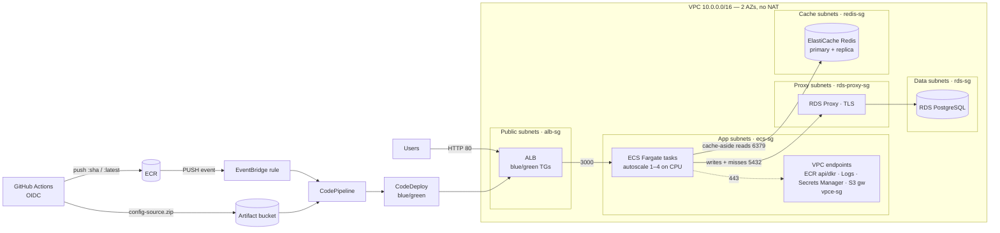

# todo-app-infra

The runtime for the **Todo App**, deployed with CloudFormation Git sync from a
root template plus one nested template per layer. It imports the
`todo-app-foundation` exports and creates the network, security groups, VPC
endpoints, load balancer, RDS PostgreSQL + RDS Proxy, ElastiCache for Redis,
the ECS Fargate service, and the blue/green delivery pipeline.

Region: `us-east-1`.

## Architecture



A richer AWS-icon version is in [`docs/architecture.py`](docs/architecture.py)
(diagram as code). Render it with Graphviz installed:
`uvx --with diagrams python docs/architecture.py` → `docs/architecture.png`.

### Subnets (each tier in two AZs)

| Tier   | CIDRs                         | Holds                              | Route out             |
| ------ | ----------------------------- | ---------------------------------- | --------------------- |
| public | 10.0.0.0/24, 10.0.1.0/24      | ALB                                | Internet gateway      |
| app    | 10.0.10.0/24, 10.0.11.0/24    | ECS tasks, interface endpoints     | S3 gateway endpoint only |
| data   | 10.0.20.0/24, 10.0.21.0/24    | RDS PostgreSQL                     | none (local only)     |
| proxy  | 10.0.30.0/24, 10.0.31.0/24    | RDS Proxy                          | none (local only)     |
| cache  | 10.0.40.0/24, 10.0.41.0/24    | ElastiCache Redis                  | none (local only)     |

### Security groups (one per resource)

| SG             | Inbound                          | Outbound                              |
| -------------- | -------------------------------- | ------------------------------------- |
| `alb-sg`       | 80 from 0.0.0.0/0                | 3000 to `ecs-sg`                      |
| `ecs-sg`       | 3000 from `alb-sg`               | 5432 to `rds-proxy-sg`, 6379 to `redis-sg`, 443 (endpoints) |
| `rds-proxy-sg` | 5432 from `ecs-sg`               | 5432 to `rds-sg`, 443 to `vpce-sg`    |
| `rds-sg`       | 5432 from `rds-proxy-sg` only    | none                                  |
| `redis-sg`     | 6379 from `ecs-sg`               | none                                  |
| `vpce-sg`      | 443 from `ecs-sg`, `rds-proxy-sg`| none                                  |

## Repo layout

```
todo-app-infra/
├── templates/
│   ├── infrastructure.yaml        # Root. Deployed by Git sync
│   ├── network.yaml               # VPC, 5 subnet tiers x 2 AZs, route tables
│   ├── security-groups.yaml       # One SG per resource type
│   ├── vpc-endpoints.yaml         # S3 gateway + ECR api/dkr, Logs, Secrets Manager
│   ├── load-balancer.yaml         # ALB, blue/green target groups, listener
│   ├── database.yaml              # RDS PostgreSQL + RDS Proxy
│   ├── cache.yaml                 # ElastiCache for Redis
│   ├── iam.yaml                   # Runtime + delivery roles, CI contract read
│   ├── compute.yaml               # Log group, cluster, task def, service, autoscaling
│   ├── delivery.yaml              # CodeDeploy, CodePipeline, EventBridge
│   └── ssm-parameters.yaml        # The /todo-app/deploy/* contract
├── scripts/publish-templates.sh   # Validates + uploads nested templates to S3
├── .github/workflows/publish-templates.yml
├── .cfn/infrastructure.deployment.yaml  # Git sync deployment file
└── docs/architecture.py           # Diagram as code
```

Only the root touches foundation exports (`Fn::ImportValue`); the children
take everything as parameters.

## Publishing the nested templates

Git sync deploys a single template file and does **not** run
`aws cloudformation package`, so each nested stack's `TemplateURL` must be a
real S3 URL. On every push to `main` that touches `templates/`, the
`publish-templates` workflow assumes `todo-app-infra-ci-role` over OIDC, runs `scripts/publish-templates.sh`
(validate every template, upload the nested ones to
`s3://<artifact-bucket>/infra-templates/<content-hash>/`), and commits the new
`TemplatesPrefix` to `.cfn/infrastructure.deployment.yaml`. That commit is what
Git sync deploys. The prefix is a content hash, so unchanged templates produce
no commit.

Repo setup: in the `dev` GitHub environment, add the **secret** `AWS_ROLE_ARN`
= `arn:aws:iam::605134436600:role/todo-app-infra-ci-role`. If `main` is
protected, allow GitHub Actions to push to it.

## IAM roles you create once

Two roles live outside every stack, so create them once with the CLI. The
policy documents are in [`iam/`](iam/).

| Role | Assumed by | Purpose |
| --- | --- | --- |
| `todo-app-infra-ci-role` | GitHub Actions (OIDC), this repo's `dev` environment or `main` | Validate templates, upload them to `s3://<artifact-bucket>/infra-templates/` |
| `todo-app-infra-deploy-role` | CloudFormation Git sync and CloudFormation | Create every resource in this stack and its nested stacks |

The deploy role is a least-privilege replacement for the bootstrap's
`AdministratorAccess` role: each AWS service the stack uses is limited to
`us-east-1`, and IAM, SSM, Secrets Manager, S3, EventBridge and nested-stack
permissions are limited to `todo-app` names. Its nested-stack statement
assumes the root stack is named `todo-app-infra`.

Run these from the repo root (Git Bash):

```bash
# 1. Publishing role for the publish-templates workflow
aws iam create-role --role-name todo-app-infra-ci-role \
  --description "GitHub Actions (todo-app-infra) publishes nested templates" \
  --assume-role-policy-document file://iam/infra-ci-trust-policy.json \
  --tags Key=Project,Value=todo-app
aws iam put-role-policy --role-name todo-app-infra-ci-role \
  --policy-name publish-templates \
  --policy-document file://iam/infra-ci-policy.json

# 2. Deploy role CloudFormation uses to create the stack's resources
aws iam create-policy --policy-name todo-app-infra-deploy-policy \
  --policy-document file://iam/infra-deploy-policy.json \
  --tags Key=Project,Value=todo-app
aws iam create-role --role-name todo-app-infra-deploy-role \
  --description "CloudFormation Git sync deploys the todo-app-infra stack" \
  --assume-role-policy-document file://iam/infra-deploy-trust-policy.json \
  --tags Key=Project,Value=todo-app
aws iam attach-role-policy --role-name todo-app-infra-deploy-role \
  --policy-arn arn:aws:iam::605134436600:policy/todo-app-infra-deploy-policy
```

After editing `iam/infra-deploy-policy.json`, publish a new version with
`aws iam create-policy-version --policy-arn <arn> --policy-document file://iam/infra-deploy-policy.json --set-as-default`.

## Deploy order

1. **Foundation stack** deployed (from `todo-app-foundation`), and the two
   roles above created.
2. **App image pushed** once from `todo-app-codes` (its workflow always pushes
   `:latest`), so the ECS service has an image to start from.
3. **Templates published** (push to `main` here, or run the workflow), then
   create this stack: CloudFormation console → **Create stack → Sync from
   Git**, stack name `todo-app-infra`, deployment file
   `.cfn/infrastructure.deployment.yaml`, connection `todo-app-github`, role
   `todo-app-infra-deploy-role`.
4. **Re-run the app workflow on `main`.** The `/todo-app/deploy/*` parameters
   now exist, so it uploads `config-source.zip` then pushes `:latest`; the
   EventBridge rule starts CodePipeline → CodeDeploy blue/green.

## What it creates

- **Network:** multi-AZ VPC, five dedicated subnet tiers, no NAT gateway.
- **VPC endpoints:** S3 gateway; ECR api, ECR dkr, CloudWatch Logs, Secrets
  Manager interface endpoints (private DNS).
- **Load balancer:** internet-facing ALB, blue and green target groups
  (`/health`), HTTP listener on 80.
- **Database:** RDS PostgreSQL 16 (db.t3, gp3, encrypted, not public) using the
  foundation's master secret; RDS Proxy (TLS required, SCRAM auth) in its own
  subnets and SG.
- **Cache:** ElastiCache for Redis 7.1, at-rest + in-transit encryption, AUTH
  token from the foundation, primary + replica with Multi-AZ failover.
- **Compute:** ECS cluster (Container Insights), bootstrap task definition
  mirroring the app repo's `deploy/taskdef.json`, Fargate service with the
  `CODE_DEPLOY` controller in the app subnets, CPU target tracking (min 1,
  desired 1, max 4, target 60%). Logs to `/ecs/todo-app`.
- **Delivery:** CodeDeploy ECS blue/green (all-at-once, auto-rollback, blue
  kept 5 min), CodePipeline V2 (S3 config + ECR image sources →
  CodeDeployToECS), EventBridge rule on ECR `PUSH` of `:latest`.
- **IAM:** task execution role (reads only the two app secrets), empty task
  role, CodeDeploy, pipeline and EventBridge roles, plus a policy on the
  foundation CI role to read `/todo-app/deploy/*` and describe ECR images.

## The contract it fulfils

`/todo-app/deploy/` → `execution-role-arn`, `task-role-arn`, `log-group`,
`db-proxy-endpoint`, `db-secret-arn`, `redis-endpoint`,
`redis-auth-secret-arn`, `artifact-bucket`.

## Parameters worth knowing

| Parameter | Default | Notes |
|---|---|---|
| `ProjectName` | `todo-app` | Must match the foundation stack |
| `TemplatesPrefix` | set by the workflow | Content-hash prefix of the nested templates |
| `ImageTag` | `latest` | Tag the service bootstraps from and the pipeline tracks |
| `DesiredCount` / `MinCount` / `MaxCount` | 1 / 1 / 4 | Service and autoscaling |
| `CpuTargetValue` | 60 | Target average CPU % |
| `DBInstanceClass` | `db.t3.micro` | db.t3 family |
| `DBMultiAZ` | `false` | `true` for a standby DB in the second AZ |
| `RedisMultiAZ` | `true` | Replica + automatic failover |

## Tagging

Stack tags in `.cfn/infrastructure.deployment.yaml` (`Project`, `Environment`,
`Owner`, `CostCenter`, `ManagedBy`) propagate to every nested stack and every
taggable resource. Each nested stack also carries a `Layer` tag, and resources
carry `Name` (plus `Tier` on subnets).

## Deliverables

- **ALB endpoint:** stack output `AlbEndpoint`.
- **Logs:** CloudWatch log group output `LogGroupName`.

## Caveats

- CloudFormation cannot change the ECS service's task definition, load
  balancer or network config after creation (CodeDeploy owns them). Changing
  those requires replacing the service.
- HTTP only: HTTPS needs a domain and an ACM certificate.
- The database uses `DeletionPolicy: Delete` (lab setting). Switch to
  `Snapshot` to keep data on stack deletion.
- Cost: four interface endpoints x 2 AZs, the ALB, RDS, RDS Proxy and two
  Redis nodes bill hourly. There is no NAT gateway. Set `RedisMultiAZ: "false"`
  for a single cache node when HA is not needed.
- Teardown: delete this stack first, then the foundation (empty its buckets),
  then the bootstrap.
